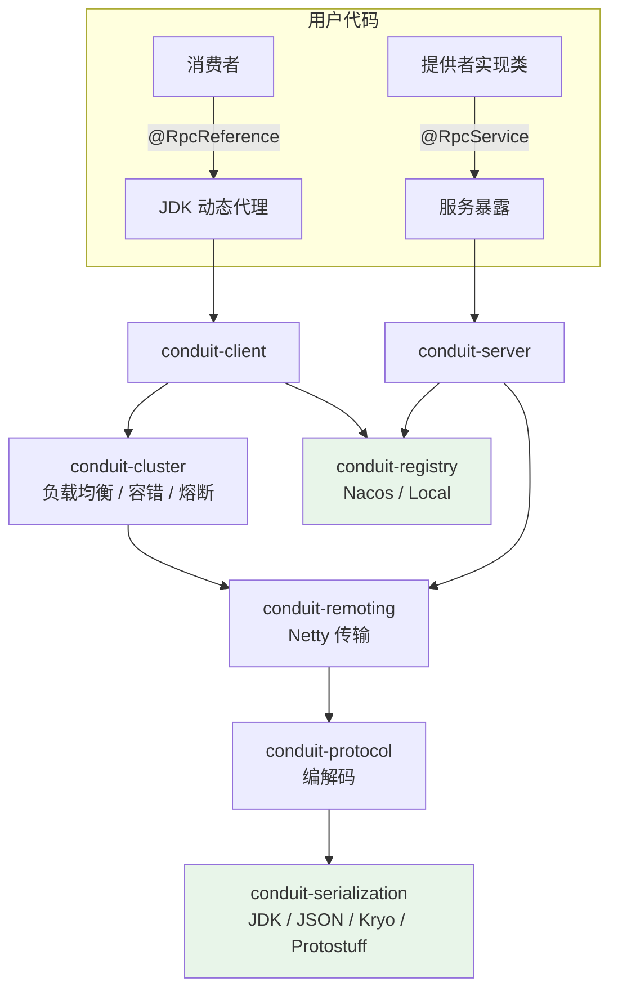

# Conduit RPC Framework

> 一个从零设计并实现的轻量级 Java RPC 框架，用于深入理解微服务通信底层机制。


Conduit 是一个基于 Java 17 + Netty 实现的轻量级 RPC 框架，目标不是替代成熟 RPC 框架，而是通过完整实现 协议设计、网络通信、服务发现、动态代理、负载均衡、集群容错、SPI 扩展以及 Spring Boot 集成，深入理解一次本地方法调用如何跨越网络转换为远程调用。

## ✨ 核心特性
- **🔌 极致的可替换性**：业务代码零改动，仅通过 SPI 配置切换底层实现
    - **序列化**：JDK / JSON / Kryo / Protostuff
    - **注册中心**：Nacos / ZooKeeper / Etcd
    - **负载均衡**：Random / RoundRobin / ConsistentHash
    - **集群容错**：FailFast / FailOver / FailSafe / FailBack
- **📦 自定义协议**：定长消息头 + 变长 Body，彻底解决拆包粘包问题
- **🛡️ 可靠传输**：协议版本协商（握手 + 能力协商）、GZIP 压缩、TLS 链路加密、连接池、心跳保活、断线自动重连
- **⚙️ 自研 SPI 机制**：`@SPI` + `ExtensionLoader`，按名加载 + 单例缓存
- **🔄 同步/异步双模**：基于 `CompletableFuture` 的请求响应关联
- **🛡️ 三态熔断器**：Closed / Open / HalfOpen 自动状态流转
- **🌱 Spring 深度整合**：`@EnableConduit` / `@RpcService` / `@RpcReference`

> 📖 **快速开始？** 请参阅 [使用手册 USER_GUIDE.md](docs/USER_GUIDE.md)

---

## 🏗️ 整体架构



### 核心流程

1. **调用拦截**：消费端调用接口方法，JDK 动态代理拦截并生成 `RpcRequest`
2. **服务发现**：查询 Registry 获取该服务当前可用的 Provider 节点列表
3. **选址容错**：Cluster 按负载均衡策略选节点，经熔断器过滤故障节点，失败时按策略重试（默认 FailOver）
4. **编码传输**：`RpcRequest` 序列化编码后，通过 Netty 长连接发送到 Provider
5. **反射执行**：Provider 端解码还原请求，从服务缓存取出实现类并反射调用目标方法
6. **响应回传**：执行结果编码为 `RpcResponse`，复用同一 requestId 写回连接
7. **响应关联**：Consumer 端按协议头 requestId 匹配等待中的 Future，唤醒并把结果返回调用方

---

## 🧱 模块结构

共 12 个 `conduit-*` 模块，严格分层，**下层绝不依赖上层**，`api` 与 `common` 处于最底层；`conduit-example` 是示例聚合模块（不参与远程仓库发布），内含 `conduit-demo` 与 `conduit-starter-demo`（后者又聚合 api/provider/consumer 三个子工程）。

```text
Conduit/
├── conduit-api                    # 对外契约：RpcRequest/RpcResponse/ServiceMeta + 注解
├── conduit-common                 # 公共基础：常量/工具类/异常 + SPI 引擎
├── conduit-protocol                # 自定义协议：消息头 + RpcEncoder/RpcDecoder
├── conduit-serialization           # Serializer 接口 + JDK/JSON/Kryo/Protostuff
├── conduit-registry                # Registry 接口 + Nacos/Local
├── conduit-remoting                # Netty 传输底座：NettyServer/NettyClient + 心跳
├── conduit-server                  # 服务端：暴露 + 扫描 + 分发 + 注册
├── conduit-client                  # 客户端：动态代理 + 发现 + 集群 + 调用
├── conduit-cluster                 # 集群容错：LoadBalancer/Cluster/CircuitBreaker
├── conduit-spring                  # Spring 整合：@EnableConduit/@RpcService/@RpcReference
├── conduit-spring-boot-starter     # Spring Boot Starter：依赖即自动装配，无需@EnableConduit
└── conduit-example                 # 示例聚合（不发布）
    ├── conduit-demo                     # 可运行示例：api / provider / consumer（编程式）
    └── conduit-starter-demo             # starter用法示例（聚合）
        ├── conduit-starter-demo-api         # 共享接口
        ├── conduit-starter-demo-provider    # 提供者进程
        └── conduit-starter-demo-consumer    # 消费者进程
```

| 模块 | 职责 |
| --- | --- |
| **conduit-api** | 核心数据模型 `RpcRequest` / `RpcResponse` / `ServiceMeta`，注解 `@RpcService` / `@RpcReference` / `@EnableConduit`。用户代码与各模块都依赖它。 |
| **conduit-common** | 常量、工具类（`NetUtils` / `StringUtils`）、异常体系，以及 SPI 引擎 `@SPI` + `ExtensionLoader`。 |
| **conduit-protocol** | 协议常量、消息头、编解码器 `RpcEncoder` / `RpcDecoder`。 |
| **conduit-serialization** | `Serializer` 接口（`@SPI`）+ `JdkSerializer` / `JsonSerializer` / `KryoSerializer` / `ProtostuffSerializer`。 |
| **conduit-registry** | `Registry` 接口（`@SPI`）+ `NotifyListener` + `NacosRegistry` / `InMemoryRegistry`；可继续扩展其他注册中心。 |
| **conduit-remoting** | `NettyServer` / `NettyClient`、协议握手（版本/codec/压缩能力协商）、连接池、心跳保活、断线重连、TLS，以及 requestId → `CompletableFuture` 关联表。 |
| **conduit-server** | 服务暴露、`@RpcService` 扫描、服务缓存 `Map<String,Object>`、反射分发、向注册中心 `register`。 |
| **conduit-client** | JDK 动态代理、`RpcClient`、同步/异步发起调用，整合发现 + 集群 + 负载均衡 + 序列化。 |
| **conduit-cluster** | `LoadBalancer`（`@SPI`）、`Cluster`（`@SPI`）、`CircuitBreaker`。 |
| **conduit-spring** | `@EnableConduit`、`@RpcService` 自动暴露、`@RpcReference` 自动注入（`BeanPostProcessor`）、自动配置。 |
| **conduit-spring-boot-starter** | 纯依赖聚合（starter 约定）：引入即自动装配，无需显式 `@EnableConduit`。 |
| **conduit-example** | 示例聚合模块（`maven.deploy.skip=true`，不发布）：`conduit-demo`（编程式直连/Nacos/Spring 示例）+ `conduit-starter-demo`（跨两个真实 Spring Boot 进程、经 Nacos 验证 starter 自动装配）。 |

---

## 🧩 可替换性演示

### 换序列化

四种序列化全部实现 `Serializer` 接口并通过 `@SPI` 注册，切换只需改一行配置：

```yaml
conduit:
  protocol:
    serialization: kryo   # jdk -> json -> kryo -> protostuff，按名字加载，业务零改动
```

序列化类型 id 会写进协议头的 `codec` 字段，解码端据此用同名 `Serializer` 反序列化 —— 收发两端各自配置即可，无需在任何业务代码里硬编码。

### 换注册中心（业务零改动）

注册中心全部实现 `Registry` 接口（`register` / `unregister` / `discover` / `subscribe`），上层只面向接口编程。在 Nacos 与 Local 之间切换，业务代码一行不动，只改配置：

```yaml
# Nacos（默认，首选）
conduit.registry.type: nacos
conduit.registry.address: 127.0.0.1:8848
```

```yaml
# 切换为进程内 Local 注册中心，适合测试和同 JVM 场景
conduit.registry.type: local
```

---

## ⚙️ 常用配置

| 配置项 | 说明 | 可选值 / 默认 |
| --- | --- | --- |
| `conduit.protocol.timeout` | 调用超时（毫秒） | 默认 `3000` |
| `conduit.cluster.retries` | 失败重试次数（FailOver 生效） | 默认 `2` |
| `conduit.cluster.loadbalance` | 负载均衡策略 | `random`(默认) / `roundrobin` / `consistenthash` |
| `conduit.cluster.strategy` | 集群容错策略 | `failover`(默认) / `failfast` / `failsafe` / `failback` |
| `conduit.protocol.serialization` | 序列化方式 | `jdk` / `json` / `kryo`(生产推荐) / `protostuff` |
| `conduit.protocol.compress` | 压缩算法（达到阈值才真正压缩） | `none`(默认) / `gzip` |
| `conduit.transport.max-connections-per-address` | 每地址连接数上限（连接池） | 默认 `1`（单长连接复用） |
| `conduit.transport.heartbeat-interval-ms` | 心跳间隔，`0` 关闭 | 默认 `30000` |
| `conduit.transport.reconnect.enabled` | 断线后台自动重连 | 默认 `true` |
| `conduit.transport.tls.enabled` | 链路加密（TLS） | 默认 `false` |
| `conduit.registry.type` | 注册中心类型 | `nacos`(默认) / `local` |
| `conduit.protocol.weight` | 服务节点权重 | 默认 `100` |

---

## 🗺️ 开发路线

| 版本 | 状态 | 目标 |
| --- | --- | --- |
| **M1** | ✅ | Netty + JDK 序列化 + 动态代理 + 同步调用（直连，无注册中心），打通端到端。 |
| **M2** | ✅ | Nacos 注册中心 + 服务发现（消费者去掉写死地址）。 |
| **M3** | ✅ | SPI（`ExtensionLoader`）+ Kryo / JSON / Protostuff，序列化可替换落地。 |
| **M4** | ✅ | 异步（`CompletableFuture`）+ 负载均衡（Random/RoundRobin/ConsistentHash）+ 集群容错（FailFast/Over/Safe/Back）+ 熔断。 |
| **M5** | ✅ | Spring 集成 + 注解驱动（`@EnableConduit`/`@RpcService`/`@RpcReference`）+ `application.yml` 自动配置。 |
| **传输层加固** | ✅ | 协议版本协商、数据压缩、TLS、连接池、心跳保活、断线自动重连；底层通信稳定可靠（见 [TRANSPORT.md](docs/TRANSPORT.md)）。 |

> 构建需 **JDK 17**（Spring Boot 3.x 要求）：`set JAVA_HOME=<jdk17>` 后 `mvn clean test`

---

## 📚 设计文档

| 文档 | 内容 |
| --- | --- |
| [USER_GUIDE.md](docs/USER_GUIDE.md) | **使用手册**：引入坐标、三种用法、配置项、序列化/容错/异步 |
| [TRANSPORT.md](docs/TRANSPORT.md) | **传输层与协议**：帧格式、版本协商、压缩、心跳、连接池、断线重连、TLS、不变量 |
| [FLOWCHARTS.md](docs/FLOWCHARTS.md) | **全局流程与流转图**：端到端时序、决策层、协议帧、SPI、注册发现、熔断状态机、线程模型、Spring 启停|
| [ARCHITECTURE.md](temp/ARCHITECTURE.md) | 整体架构、模块分层、调用链路 |
| [PROTOCOL.md](docs/PROTOCOL.md) | 自定义协议、消息头逐字段、拆包粘包 |
| [CALL_FLOW.md](docs/CALL_FLOW.md) | 端到端调用链路图：序列化/传输/识别（magic·length·codec·requestId）|
| [SERIALIZATION.md](docs/SERIALIZATION.md) | 序列化接口与四种实现 |
| [REGISTRY.md](docs/REGISTRY.md) | 注册中心抽象、Nacos 与 Local 实现 |
| [SPI.md](docs/SPI.md) | `@SPI` + `ExtensionLoader` 机制 |
| [RPC.md](docs/RPC.md) | 服务端/客户端调用链路与异步 |
| [CLUSTER.md](docs/CLUSTER.md) | 负载均衡、容错、熔断 |
| [SPRING.md](docs/SPRING.md) | Spring 整合与注解驱动 |
| [ROADMAP.md](temp/ROADMAP.md) | 开发路线 M1~M5|
| [BACKLOG.md](temp/BACKLOG.md) | 后续增强（更多注册中心、熔断增强、限流/隔离、TLS、泛化调用、可观测性、Javassist 代理、配置中心）|

---

## 🤝 参与贡献

欢迎 Issue / PR，流程与规范见 [CONTRIBUTING.md](CONTRIBUTING.md)；版本变更记录见 [CHANGELOG.md](CHANGELOG.md)。

---

## 📄 License

[Apache-2.0](LICENSE)
