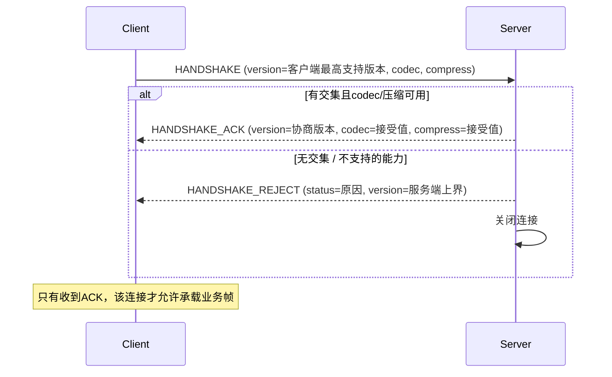
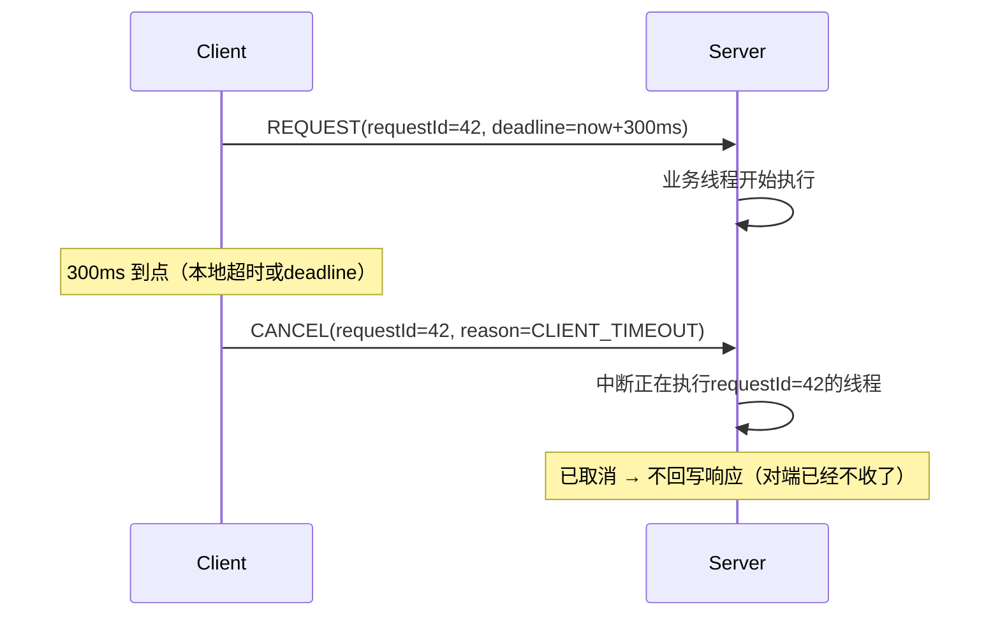

# Conduit 传输层与协议（Transport & Protocol）

本文档描述 Conduit 的「地基」：`conduit-protocol`（帧格式与编解码）与 `conduit-remoting`
（Netty 传输、握手、心跳、连接池、断线重连、TLS）。这一层被设计为**稳定层**：后续迭代只做
bug 修复，新增能力尽量以"可选项 + 默认关闭"的方式加入，不改变既有字节布局与调用语义。

---

## 1. 组件与职责

| 组件 | 职责 |
| --- | --- |
| `RpcMessage` | 一帧的内存表示：头字段 + 可选的 `RpcRequest`/`RpcResponse` payload |
| `RpcEncoder` / `RpcDecoder` | 对象 ↔ 字节：定长头 + 序列化/压缩后的 body |
| `ProtocolOptions` | 协议默认项：codec、压缩算法、压缩阈值 |
| `NettyServer` | 监听、握手、心跳回应、业务派发、优雅停机 |
| `NettyClient` | 建连、握手、选连接、发送、关联响应、超时清理、保活、重连 |
| `ConnectionPool` | 每地址连接集合：单飞建链、按负载选连接、扩容到上限、闲置回收 |
| `ReconnectManager` | 断线后按指数退避在后台重建连接 |
| `ClientHandshakeHandler` / `ServerHandshakeHandler` | 版本 + 能力（codec/压缩）协商 |
| `ClientHeartbeatHandler` / `ServerHeartbeatHandler` | PING/PONG 保活与读空闲探活 |
| `Tls` | 从 PEM/KeyManagerFactory 构建 `SslContext`，交给客户端/服务端启用链路加密 |

---

## 2. 帧格式（18 字节定长头 + 变长 body）

```text
 0       2         3      4       5          6          14       18              18+N
+-------+---------+------+-------+----------+-----------+--------+----------------+
| magic | version | type | codec | compress | requestId | length | body (N bytes) |
+-------+---------+------+-------+----------+-----------+--------+----------------+
|   2   |    1    |   1  |   1   |     1    |     8     |    4   |        N       |
```

| 字段 | 说明 |
| --- | --- |
| `magic` | 固定 `0xCAFE`，第一道防线，非法直接断开 |
| `version` | 帧格式版本；握手帧里是「提议版本」，ACK 帧里是「协商结果」 |
| `type` | `1` 请求 / `2` 响应 / `3` 心跳 / `4` 握手 / `5` 握手ACK / `6` 握手拒绝 / `7` 取消 |
| `codec` | 序列化 id：`1` jdk / `2` json / `3` kryo / `4` protostuff |
| `compress` | 压缩算法：`0` 无 / `1` gzip；握手帧里是「压缩能力提议」 |
| `requestId` | 请求-响应关联的唯一凭证（控制帧为 0） |
| `length` | body 字节数（压缩后的最终长度） |

控制帧：

- **心跳**：`length=0`，无 body。
- **握手 / ACK / 拒绝**：body 固定 1 字节 `status`，**不经过序列化器**——协商前两端还没约定
  codec，用序列化器会造成"先有鸡还是先有蛋"。
- **取消（CANCEL）**：`requestId` 指向**被取消的那次请求**，body 固定 1 字节原因
  （`0` 客户端超时 / `1` 调用方放弃 / `2` deadline 到点），同样不经过序列化器——
  被取消的请求可能还没跑完，与它的 codec 无关。

> **为什么是 18 字节而不是 16 字节？**
> 18 字节头是项目自 M1 起的既有布局，本次传输层加固**没有改变头长度**：版本协商等新能力
> 只复用了原有的 `version`/`codec`/`compress` 字段，并新增 `type` 取值（`4/5/6`）与 1 字节
> 控制帧 body，头字段顺序与偏移表完全不变。
> 设计阶段评估过把 `type/codec/compress` 合并为一个 `flags` 字节的 16 字节方案
> （`magic2 + version1 + flags1 + requestId8 + length4`，见 `temp/PROTOCOL.md`），
> 但需要位运算拆解、各子字段取值范围受限、可读性下降，仅换来 2 字节收益，故未采用。

---

## 3. 协议版本协商

版本协商发生在连接建立后、任何业务帧之前：



规则：

- 客户端提议自己支持的**最高**版本；服务端在 `[MIN_SUPPORTED_VERSION, MAX_SUPPORTED_VERSION]`
  与提议之间取交集最高版：
  - 未来客户端（如 v9）连当前服务端 → 平滑降级到 v1（向后兼容）；
  - 远古客户端（如 v0）连 v1 服务端 → 无交集，回 `HANDSHAKE_NO_COMMON_VERSION` 并断开。
- 服务端校验提议的 codec 能加载、压缩算法支持，否则回 `UNSUPPORTED_CODEC` / `UNSUPPORTED_COMPRESS`。
- 握手完成前收到业务帧 → **断开连接**（协议违规），防止未协商的连接绕过版本/算法校验。
- 握手有超时（默认 3s）；未按时握手的连接会被清理。
- 服务端对重复握手是幂等的：回放已协商结果，不会重复协商。

解码器的防御边界：业务帧的 `version` 必须落在本端点支持区间，`length` 必须非负且不超过
`MAX_FRAME_LENGTH`；魔数/类型/codec/压缩算法非法一律断开。请求 body 反序列化失败时回一帧
错误响应（客户端快速失败），响应 body 失败则断开（无法关联，由在途请求统一失败）。

---

## 4. 数据压缩

- 算法由 `compress` 字段逐帧携带，压缩发生在序列化之后、写 socket 之前。
- **压缩阈值**：只有 body 达到阈值（默认 1024 字节）才真正压缩；小报文压缩后反而更大，
  且多一次 CPU 开销。阈值 0 表示无条件压缩（便于压测对比）。
- 头里记录的是**实际**使用的算法：低于阈值时回填 `COMPRESS_NONE`，接收端以头为准。
- 能力协商：客户端提议压缩算法，服务端不支持时握手直接拒绝（`UNSUPPORTED_COMPRESS`），
  不会出现"一端压缩、一端不认"的错位。
- 解压上限：解压后字节数超过 `MAX_FRAME_LENGTH * 4` 判为解压炸弹并中止，避免高压缩比报文撑爆堆。

---

## 5. 心跳保活

TCP 在"对端断电/中间设备静默丢包"时不会主动通知应用，长连接会变成半开状态。Conduit 用
PING/PONG 双向保活：

- **客户端**：写空闲达到 `heartbeat-interval-ms` → 发一帧 PING（不进入业务关联表）；
  读空闲达到 `read-idle-timeout-ms`（必须大于心跳间隔）→ 判定对端失联，关闭连接。
- **服务端**：收到 PING 立即回 PONG（原样带回 requestId/version）；读空闲超过
  `server.reader-idle-timeout-ms` 没有任何帧 → 关闭失联连接。
- 连接断开后，在途请求立即失败（不干等到调用超时），并触发后台重连。

---

## 6. 取消与 deadline（CANCEL 控制帧）

**问题**：客户端超时只是"我不等了"，服务端线程仍在跑那个已经没人要的方法。上游一次超时会
在下游放大成一串白跑的长尾请求。

**解法**：把"不等了"这个事实显式送达对端。



两条触发路径，共用服务端同一张在途表（`ServerCallRegistry`）：

| 触发方 | 条件 | 服务端行为 |
| --- | --- | --- |
| 客户端 | 本地超时 / `future.cancel` | 发 `CANCEL`，其中 `reason` 标明原因 |
| 服务端自己 | 请求 attachment 的 `conduit.deadline` 到点 | 中断执行线程；因对端可能还在等，回一帧错误说明 |

**deadline 的传递规则**：`deadline` 是**绝对时间**（epoch 毫秒），放在 attachments 里随请求
下发。每一跳取 `min(上游deadline, now+本地超时)`：

```text
A(超时1000) → B(超时1000) → C
A 给 B 的 deadline = T+1000
B 给 C 的 deadline = min(T+1000, T_B+1000)
```

- 上游给了更早的截止时间，下游就按剩余预算发请求、按剩余预算等待——不会出现"上游 1s 就放弃、
  下游还在按自己的 3s 超时等着"；
- 已经过期的请求到达服务端时**连业务线程都不占用**，直接回错误；
- 每一跳的传输超时也是剩余预算（`RpcAttachments.budgetMillis`），重试同样被 deadline 收敛。

**中断语义**：取消时对正在执行业务方法的线程 `Thread.interrupt()`。业务方法若在 `sleep`/
`wait`/阻塞IO 上会立刻以 `InterruptedException` 结束；若它不响应中断，框架不会强杀线程，只是
不再回写响应（对调用方而言结果一样：早就不等了）。线程归还业务线程池前会清掉中断标记，避免
把标记带给线程池里的下一个任务。

---

## 7. 连接池

- 每个目标地址一个连接池；默认 `max-connections-per-address=1`，即"一条长连接复用"。
- 配置 >1 时：
  - 按**在途请求数最少**选择连接；
  - 当所有连接都有在途请求且未达上限时，后台异步补建连接（不阻塞当前请求）；
  - 每地址连接数绝不超过上限。
- **单飞建链**：同一地址同一时刻只允许一个建链过程，其它调用共享同一个 future，避免
  Connection Refused 风暴。
- **握手后可用**：连接只有协议握手成功才进入池中，池里取到的连接一定可直接承载业务帧。
- **闲置回收**：无在途请求且空闲超过 `idle-connection-timeout-ms` 的连接被后台回收
  （默认 10 分钟；保留 `minIdle=0` 条）。
- 连接关闭即从池中移除，并通知重连管理器。

---

## 8. 断线自动重连

- 连接断开后，`ReconnectManager` 在后台按**指数退避**重连：
  `delay = min(base << (attempt-1), max)`，默认 1s 起步、30s 封顶、最多 5 次。
- 同一地址同一时刻只有一条重连链路（重复断开信号不会放大重连风暴）。
- 重连只是"后台尽力而为"：即使全部尝试失败，下一次真实调用仍会通过连接池按需建链，
  不影响可用性。
- provider 重启后，消费者无需发起新调用即可恢复连接（避免恢复瞬间的首调用延迟尖峰）。

---

## 9. 链路加密（TLS）

传输层只依赖一个 `SslContext`：

```java
// 服务端（PEM 证书链 + PKCS8 私钥）
SslContext serverTls = Tls.server(certChainFile, privateKeyFile, password);
new NettyServer(host, port, handler, ServerOptions.builder().sslContext(serverTls).build());

// 客户端（信任CA + HTTPS主机名校验）
SslContext clientTls = Tls.client(trustCertFile); // 默认 endpointIdentificationAlgorithm=HTTPS
new NettyClient(ClientOptions.builder().sslContext(clientTls).build());
```

- 使用 JDK SSL provider（不依赖 netty-tcnative/OpenSSL），行为跨 JVM 一致。
- 客户端默认开启 HTTPS **主机名校验**，防止"证书合法但被指向其它主机"的中间人攻击；
  内网自签/受控环境可显式关闭（`Tls.client(tmf, null)` 或 `Tls.insecureClient()`，后者不校验）。
- TLS 握手与应用层协议握手的次序：TLS 完成后再发 HANDSHAKE，握手超时也从 TLS 完成后开始计时。
- 也支持从 `KeyManagerFactory` / `TrustManagerFactory` 构建（keystore/PKCS12、mTLS 场景）。

---

## 10. 配置

### Spring Boot（`application.yml`）

```yaml
conduit:
  protocol:
    serialization: kryo       # jdk/json/kryo/protostuff
    compress: gzip            # none/gzip（客户端提出，服务端支持则接受）
    compress-threshold: 1024
  transport:
    connect-timeout-ms: 3000
    handshake-timeout-ms: 3000
    heartbeat-interval-ms: 30000
    read-idle-timeout-ms: 90000
    max-connections-per-address: 1
    idle-connection-timeout-ms: 600000
    reconnect:
      enabled: true
      max-attempts: 5
      base-delay-ms: 1000
      max-delay-ms: 30000
    server:
      business-threads: 200
      queue-capacity: 10000
      reader-idle-timeout-ms: 60000
      shutdown-timeout-ms: 10000
    tls:
      enabled: false
      cert: ""               # 服务端证书链PEM（支持 classpath:）
      key: ""                # 服务端私钥PEM
      key-password: ""
      trust-cert: ""         # 客户端信任的CA/证书PEM；留空用JVM默认信任库
      insecure: false        # 客户端跳过校验（仅测试）
```

### 编程式

```java
ClientOptions clientOptions = ClientOptions.builder()
        .codec(SerializerType.idOf("kryo"))
        .compress(ProtocolConstants.COMPRESS_GZIP)
        .maxConnectionsPerAddress(2)
        .heartbeatIntervalMillis(30_000)
        .reconnectMaxAttempts(10)
        .sslContext(Tls.client(trustCertFile))
        .build();
RpcClient client = new RpcClient(clientOptions);

ServerOptions serverOptions = ServerOptions.builder()
        .businessThreads(64)
        .readerIdleTimeoutMillis(60_000)
        .sslContext(Tls.server(certFile, keyFile, null))
        .build();
new RpcServer(host, port, serverOptions);
```

---

## 11. 不变量（修改协议/传输层时必须保持）

1. 头字段顺序与长度不变；新增字段走 `version` 协商或 `type` 扩展。
2. 握手完成前不承载业务帧；握手失败/超时的连接必须关闭，不得进入连接池。
3. 业务帧的 version 必须等于协商结果（或至少落在两端支持区间）。
4. 请求-响应关联只依赖头里的 `requestId`；`RpcRequest`/`RpcResponse` 不带 id。
5. 编解码层只依赖 `Serializer` 接口与 `SerializerFactory`，不得出现具体序列化实现。
6. 在途请求必须在 响应/写失败/连接断开/超时 四条路径上都被清理（无泄漏）。
7. 连接池中的连接数不超过配置上限；握手成功的连接才可复用。
8. 控制帧（心跳/握手/取消）的 body 布局固定且不经过序列化器；解码器的控制帧分支必须先于
   "业务帧类型校验"，否则新增控制帧会被当成非法类型直接断链。
9. 服务端每个在途请求必须在 完成/cancel 帧/deadline 三条路径上都从 `ServerCallRegistry` 移除；
   业务线程归还线程池前必须清掉中断标记。
